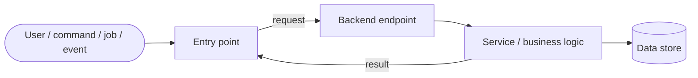

# <Feature Name>

## Summary
<One or two sentences: what this feature is, in business terms. Scope each doc to **one feature** — don't bundle separate features into a single write-up without strong cause. If the "feature" spans two genuinely distinct capabilities (different users, purposes, or flows), it's almost certainly two features and belongs in two docs.>

## Business purpose
<Why it exists — the user or business problem it solves.>

## User-facing behavior
<What a user can do; the key flows.>

## Components built

Two sets — backend and frontend. **Keep these as tables** — the columnar layout is what makes the components scannable and comparable at a glance, and prose paragraphs here quickly become unreadable. List each component that was built or materially changed for this feature, one component per row (don't merge several into a single cell). **Make each component name a Markdown link to its source file** — `[<Name>](<path>)` — so a reader can jump straight to the code. Leave a table empty (or drop the row) if that side isn't touched.

### Backend
| Component | Type | Responsibility |
|---|---|---|
| [`<Name>`](<path>) | controller / service / model / job / endpoint / migration / command | <what it does for this feature> |

### Frontend
| Component | Type | Responsibility |
|---|---|---|
| [`<Name>`](<path>) | page / view / component / hook / store / api-client | <what it renders or manages> |

## Business flows

Give **each distinct flow its own subsection with its own Mermaid diagram** — do not collapse several flows into one catch-all diagram. Most features have more than one flow (e.g. create, approve, export); each gets a `### <Flow name>` block below, and a single-flow feature simply has one. A flow isn't always user-initiated — a **command, scheduled job, or event** can kick off behavior too; start each diagram from that flow's real trigger, not always a `User`. For every flow, lead with a short description of the **business process** it serves, then the diagram tracing that specific trigger → backend → data path. Replace the placeholder nodes with the real path.

### <Flow name>
<One or two sentences on the business process: what initiates this flow (a user, a command, a scheduled job, an event), what it's trying to accomplish, and the resulting outcome.>

<Repeat a `### <Flow name>` block — description plus its own diagram — for each additional distinct flow.>

## Data & persistence

What this feature stores or relies on — only the data it **owns or materially reads/writes**, not the whole schema. Drop this section entirely if the feature is stateless. Give **each store its own subsection**: link its heading to the model/migration that defines it, describe the store's purpose, then a table with **one row per column/field** explaining what that column is used for.

### [`<table / collection / model>`](<path>)
<The store's purpose — what one row/document represents and the role it plays for this feature.>

| Column | Type | Description |
|---|---|---|
| `<column>` | `<type>` | <what this column is used for> |

<Repeat a `### <store>` block — purpose plus its column table — for each additional store.>

## Access & configuration

**Who can use it** and **what gates or tunes it**. Omit either part that doesn't apply.

- **Permissions:** <roles, scopes, or ownership checks required, and where they're enforced.>
- **Configuration:** <feature flags, env vars, or settings — name, where set, and what they change.>

## Related
<Links to related feature/architecture docs.>
