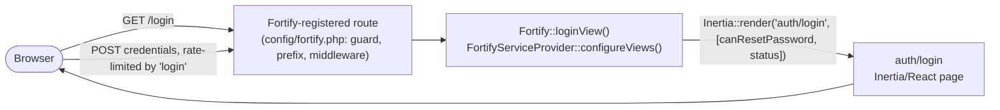

# Fortify Authentication

## Purpose & scope

Laravel Fortify is the frontend-agnostic authentication backend for this application. It registers Fortify's own routes and controllers for login, password reset, email verification, two-factor authentication, password confirmation, and passkeys (WebAuthn), and this app wires those routes to two things: Inertia-rendered React pages (instead of Fortify's default Blade views) and a small set of app-owned action classes and validation-rule concerns that encode this app's specific rules.

This doc covers that shared backend wiring — the [`FortifyServiceProvider`](app/Providers/FortifyServiceProvider.php) bindings, [`config/fortify.php`](config/fortify.php), the [`User`](app/Models/User.php) model's Fortify contracts/traits, the reusable validation-rule concerns, the named rate limiters, and the database columns those features persist to. It is scoped to the cross-cutting backend, not to any single flow: end-to-end user-facing behavior for password reset, password confirmation, and profile settings is documented per-feature under `docs/features/`, and the React/Inertia client architecture is covered separately in `inertia-react-spa.md`.

## Where it's used

- **Login** — guarded by the `login` rate limiter; guard/provider come from `config/fortify.php` (`guard`) and `config/auth.php` (`guards.web` / `providers.users`).
- **Password reset** — enabled via `Features::resetPasswords()`; persistence handled by [`ResetUserPassword`](app/Actions/Fortify/ResetUserPassword.php). See [Password reset](docs/features/password-reset.md).
- **Email verification** — enabled via `Features::emailVerification()`, rendered through `Fortify::verifyEmailView()`.
- **Two-factor authentication** — enabled via `Features::twoFactorAuthentication()`; backed by the `TwoFactorAuthenticatable` trait on `User` and the `two_factor_*` columns; challenges rate-limited by the `two-factor` limiter.
- **Passkeys (WebAuthn)** — enabled via `Features::passkeys()`; backed by the `PasskeyUser` contract / `PasskeyAuthenticatable` trait on `User` and the `passkeys` table; requests rate-limited by the `passkeys` limiter.
- **Password confirmation** — gates sensitive settings via `Fortify::confirmPasswordView()` and the `confirmPassword` option on both the two-factor and passkeys features. See [Password confirmation](docs/features/password-confirmation.md).
- **Authenticated password change** (security settings) and **profile updates** (name/email, account deletion) sit outside Fortify's own routes but reuse its validation concerns — [`PasswordValidationRules`](app/Concerns/PasswordValidationRules.php) and [`ProfileValidationRules`](app/Concerns/ProfileValidationRules.php) are also used by `app/Http/Requests/Settings/PasswordUpdateRequest.php`, `ProfileUpdateRequest.php`, and `ProfileDeleteRequest.php`. See [Change password](docs/features/password-management.md) and [Profile settings](docs/features/profile-settings.md).

## Key abstractions / contracts

| Abstraction | Type | What it promises |
|---|---|---|
| [`PasskeyUser`](app/Models/User.php) | interface (Fortify/Passkeys contract, implemented by `User`) | Requires `passkeys()` (a `HasMany` relation), `hasPasskeysEnabled()`, `getPasskeyUserHandle()`, `getPasskeyDisplayName()`, and `getPasskeyUsername()`, so Fortify's WebAuthn flows can register and verify credentials against the model. |
| [`ResetsUserPasswords`](app/Actions/Fortify/ResetUserPassword.php) | interface (Fortify contract) | Requires a single `reset(User $user, array $input): void` method; the bound implementation owns validating and persisting the new password. |
| [`TwoFactorAuthenticatable`](app/Models/User.php) | trait (Fortify, mixed into `User`) | Provides `hasEnabledTwoFactorAuthentication()`, `recoveryCodes()`, `replaceRecoveryCode()`, and QR-code URL/SVG generation, all reading/writing the `two_factor_*` columns. |
| [`PasskeyAuthenticatable`](app/Models/User.php) | trait (Fortify/Passkeys, mixed into `User`) | Supplies the concrete `passkeys()` relation and `getPasskey*()` methods required to satisfy `PasskeyUser`. |
| [`PasswordValidationRules`](app/Concerns/PasswordValidationRules.php) | trait (concern) | Supplies `passwordRules()` (`required`, `string`, `Password::default()`, `confirmed`) and `currentPasswordRules()` (`required`, `string`, `current_password`) for any code that sets or re-verifies a password. |
| [`ProfileValidationRules`](app/Concerns/ProfileValidationRules.php) | trait (concern) | Supplies `profileRules()` / `nameRules()` / `emailRules()`, the latter enforcing email uniqueness (ignoring the current user's own row on update). |

## Invariants & guarantees

- `password` is always cast `hashed` on `User` — it is never persisted in plaintext, including when `ResetUserPassword` uses `forceFill()` to bypass mass-assignment protection.
- `password`, `two_factor_secret`, `two_factor_recovery_codes`, and `remember_token` are marked `#[Hidden]` on `User` and never appear in array/JSON serialization.
- Only `name`, `email`, and `password` are `#[Fillable]` on `User`; any other attribute requires an explicit `forceFill()`, as `ResetUserPassword` does after validating its own input.
- `ResetUserPassword` is the only Fortify action this app overrides (`app/Actions/Fortify/` contains just that one class) — every other Fortify action (registration, profile update, etc.) runs Fortify's own default implementation.
- Rate limits are per-request-key, not per-user: `login` is 5/min keyed by transliterated, lowercased username + IP; `two-factor` is 5/min keyed by the `login.id` stored in session; `passkeys` is 10/min keyed by the submitted credential ID (or session ID) + IP.
- With `Features::twoFactorAuthentication(['confirm' => true, ...])`, `hasEnabledTwoFactorAuthentication()` requires both a stored `two_factor_secret` and a non-null `two_factor_confirmed_at` — generating a secret alone does not enable 2FA.
- `Features::twoFactorAuthentication(['confirmPassword' => true, ...])` and `Features::passkeys(['confirmPassword' => true])` both require a fresh password confirmation (subject to `config/auth.php`'s `password_timeout`, 10800 seconds) before those flows can proceed.
- Fortify's guard (`config/fortify.php` `guard => 'web'`) and password broker (`passwords => 'users'`) must stay aligned with `config/auth.php`'s `guards.web` and `passwords.users` definitions, which is what resolves the `User` model via `providers.users.model`.

## Design decisions & trade-offs

- **Fortify actions over custom controllers.** Fortify's architecture binds single-purpose action classes into the container (`Fortify::resetUserPasswordsUsing()`, etc.) rather than routing to app controllers. This app only overrides the one action whose behavior differs from Fortify's default (`ResetUserPassword`), keeping the rest of the auth surface on Fortify's maintained defaults instead of re-implementing them.
- **Inertia view bindings instead of Blade.** `FortifyServiceProvider::configureViews()` replaces every Fortify Blade view with a closure returning `Inertia::render(...)`. This keeps Fortify's routing, session, and CSRF handling intact while letting the SPA own presentation, avoiding a parallel set of hand-rolled auth routes/controllers just to serve React pages.
- **`confirm` and `confirmPassword` feature options.** Two-factor authentication requires an explicit confirmation step (`confirm => true`) before it's considered enabled, and both two-factor and passkeys require a recent password confirmation (`confirmPassword => true`) before setup. This trades some user friction for protection against an unlocked, already-authenticated session being used to weaken account security.
- **Named rate limiters per surface.** `configureRateLimiting()` defines `login`, `two-factor`, and `passkeys` limiters individually (rather than relying on one shared throttle), so each can use a key suited to its abuse pattern — username+IP for login, session-scoped `login.id` for 2FA challenges, credential ID+IP for passkey attempts.
- **Secrets stay hidden and encrypted.** Two-factor and passkey-related columns are excluded from model serialization via `#[Hidden]`, and the `two_factor_secret` / `two_factor_recovery_codes` values are encrypted through Fortify's own encrypter — keeping sensitive data out of API responses and out of the database in plaintext.

## How to extend

- **Override another Fortify action.** Add a `Fortify::xUsing(YourAction::class)` call in `FortifyServiceProvider::configureActions()`, mirroring `Fortify::resetUserPasswordsUsing(ResetUserPassword::class)`, with `YourAction` implementing the matching Fortify contract under `app/Actions/Fortify/`.
- **Change a rendered auth page.** Add or edit the corresponding `Fortify::xView()` closure in `configureViews()`, passing whatever props the target Inertia page component expects.
- **Enable or disable a feature.** Add or remove the matching `Features::x()` entry in `config/fortify.php`'s `features` array (e.g. removing `Features::passkeys()` disables WebAuthn support entirely); toggle sub-options like `confirm` / `confirmPassword` within a feature's option array.
- **Add or adjust a rate limiter.** Define it with `RateLimiter::for()` in `configureRateLimiting()` and reference its name from `config/fortify.php`'s `limiters` array.
- **Reuse validation instead of duplicating it.** Add methods to `PasswordValidationRules` or `ProfileValidationRules` and pull the trait into the new action or form request rather than re-writing password/profile rules.

## Key files

| File | Responsibility |
|---|---|
| [`app/Providers/FortifyServiceProvider.php`](app/Providers/FortifyServiceProvider.php) | Boots Fortify: binds the `ResetUserPassword` action, binds Inertia view renderers for login / reset-password / forgot-password / verify-email / two-factor-challenge / confirm-password, and defines the `login`, `two-factor`, and `passkeys` rate limiters. |
| [`config/fortify.php`](config/fortify.php) | Fortify's own config: guard (`web`), password broker (`users`), username/email field, lowercasing, `home` redirect (`/dashboard`), route prefix/domain/middleware, limiter name mapping, the `views` flag, passkeys settings (relying party ID, allowed origins, user handle secret, timeout), and the enabled `features` array. |
| [`config/auth.php`](config/auth.php) | Defines the `web` guard and `users` provider (`User::class`) that Fortify's `guard`/`passwords` settings point at, plus the password confirmation timeout (`password_timeout`). |
| [`app/Models/User.php`](app/Models/User.php) | The authenticatable model: implements `PasskeyUser`; uses `HasFactory`, `Notifiable`, `PasskeyAuthenticatable`, `TwoFactorAuthenticatable`; casts `password` to `hashed` and the two timestamp columns to `datetime`; marks `password`/`two_factor_secret`/`two_factor_recovery_codes`/`remember_token` `#[Hidden]` and `name`/`email`/`password` `#[Fillable]`. |
| [`app/Actions/Fortify/ResetUserPassword.php`](app/Actions/Fortify/ResetUserPassword.php) | The only Fortify action overridden in this app: implements `ResetsUserPasswords`, validating the new password with `PasswordValidationRules` before `forceFill()` + `save()`. |
| [`app/Concerns/PasswordValidationRules.php`](app/Concerns/PasswordValidationRules.php) | Shared `passwordRules()` / `currentPasswordRules()` used wherever a password is set or re-verified. |
| [`app/Concerns/ProfileValidationRules.php`](app/Concerns/ProfileValidationRules.php) | Shared `profileRules()` / `nameRules()` / `emailRules()` used to validate name/email input, with per-user email uniqueness. |
| [`database/migrations/0001_01_01_000000_create_users_table.php`](database/migrations/0001_01_01_000000_create_users_table.php) | Creates `users` (`id`, `name`, unique `email`, `email_verified_at`, `password`, `remember_token`, timestamps), `password_reset_tokens`, and `sessions`. |
| [`database/migrations/2025_08_14_170933_add_two_factor_columns_to_users_table.php`](database/migrations/2025_08_14_170933_add_two_factor_columns_to_users_table.php) | Adds `two_factor_secret`, `two_factor_recovery_codes`, and `two_factor_confirmed_at` to `users`, backing `TwoFactorAuthenticatable`. |
| [`database/migrations/2024_01_01_000000_create_passkeys_table.php`](database/migrations/2024_01_01_000000_create_passkeys_table.php) | Creates `passkeys` (`user_id` FK cascade-on-delete, `name`, unique `credential_id`, JSON `credential`, `last_used_at`, timestamps), backing `PasskeyAuthenticatable`. |

## Diagram (optional)

How a Fortify-registered route resolves through the provider's view binding to an Inertia page, using login as the representative example:

