# Inertia + React SPA Client

## Purpose & scope
This is the client-side rendering architecture for the application: how the browser boots a single Inertia/React app (`resources/js/app.tsx`), how an Inertia page name is resolved to a wrapping layout, and the shared component/hook library (`resources/js/components/ui`, `resources/js/hooks`) that pages and layouts are built from.

Out of scope (documented elsewhere):
- Wayfinder's generated, typed route/controller functions (`resources/js/actions`, `resources/js/routes`, `resources/js/wayfinder`) — see `docs/architecture/wayfinder-typed-routing.md`.
- Fortify/auth backend internals (controllers, actions, session/2FA logic) — see `docs/architecture/fortify-authentication.md`.

## Where it's used
Every page component under `resources/js/pages/**` boots through this pipeline — `auth/*` (login, registration, password reset, 2FA challenge, email verification), `settings/*` (profile, security, appearance), `dashboard.tsx`, and `welcome.tsx`. All of them are mounted by the single `createInertiaApp` call in `resources/js/app.tsx`, wrapped by whichever layout the naming convention selects, and draw on the shared UI primitives in `resources/js/components/ui` and the hooks in `resources/js/hooks`.

## Key abstractions / contracts

| Abstraction | Type | What it promises |
|---|---|---|
| [`createInertiaApp(...)`](resources/js/app.tsx) | bootstrap call | Single client entry point: formats the document title, resolves each page's layout, wraps the whole app tree (`withApp`), enables React 19 `strictMode`, and configures the top-of-page progress bar. Inertia v3's `resolve` option is omitted here, so page components are resolved by `@inertiajs/vite`'s default convention rather than a hand-written glob/import map in this file. |
| layout resolver (`layout: (name) => ...` in [`app.tsx`](resources/js/app.tsx)) | naming convention | Maps an Inertia page name to the layout(s) that wrap it: `'welcome'` → no layout (`null`), any name starting with `'auth/'` → [`AuthLayout`](resources/js/layouts/auth-layout.tsx), any name starting with `'settings/'` → the pair [`AppLayout`, `SettingsLayout`], everything else → [`AppLayout`](resources/js/layouts/app-layout.tsx). |
| [`AppLayout`](resources/js/layouts/app-layout.tsx) | layout component | Accepts `breadcrumbs` + `children`; delegates to [`AppSidebarLayout`](resources/js/layouts/app/app-sidebar-layout.tsx) (the sidebar-chrome variant). A header-chrome variant, [`AppHeaderLayout`](resources/js/layouts/app/app-header-layout.tsx), exists alongside it but is not wired into the current layout switch. |
| [`AuthLayout`](resources/js/layouts/auth-layout.tsx) | layout component | Accepts `title`/`description`/`children`; delegates to [`AuthSimpleLayout`](resources/js/layouts/auth/auth-simple-layout.tsx) (the centered-card variant). [`AuthCardLayout`](resources/js/layouts/auth/auth-card-layout.tsx) and [`AuthSplitLayout`](resources/js/layouts/auth/auth-split-layout.tsx) are alternate variants present in the codebase but not selected by the current `AuthLayout` wrapper. |
| [`SettingsLayout`](resources/js/layouts/settings/layout.tsx) | layout component | Renders the Profile / Security / Appearance settings nav (via [`useCurrentUrl`](resources/js/hooks/use-current-url.ts) for active-link highlighting) around `children`; only reachable by being composed inside `AppLayout` via the `settings/*` layout-array case. |
| [`AppShell`](resources/js/components/app-shell.tsx) / [`AppContent`](resources/js/components/app-content.tsx) | component pair | Switch on an `AppVariant` (`'sidebar' \| 'header'`) to render either a `SidebarProvider`/`SidebarInset` pairing or a plain flex/`<main>` pairing; `AppShell` reads `sidebarOpen` off the shared Inertia page props to set the sidebar's initial open state. |
| [`cn(...inputs)`](resources/js/lib/utils.ts) | utility function | Merges Tailwind class lists via `clsx` + `tailwind-merge`; used throughout `components/ui/*` and the layout components for conditional/overridable class names. |
| [`toUrl(url)`](resources/js/lib/utils.ts) | utility function | Normalizes an `InertiaLinkProps['href']` (`string \| { url: string }`) down to a plain string; used wherever a href needs to be compared or interpolated (e.g. `SettingsLayout`, `useCurrentUrl`). |
| `resources/js/components/ui/*` | shared component library | shadcn/ui-style primitives (button, dialog, dropdown-menu, sidebar, sonner, tooltip, select, sheet, etc.) built on Radix UI primitives (`@radix-ui/react-*`) and `class-variance-authority` for variants, styled through `cn()`. |
| `resources/js/hooks/*` | shared hook library | Small, mostly `useSyncExternalStore`-based hooks: [`use-appearance`](resources/js/hooks/use-appearance.tsx) (light/dark/system theme, persisted to `localStorage` + a cookie for SSR), [`use-current-url`](resources/js/hooks/use-current-url.ts) (active-link matching), [`use-mobile`](resources/js/hooks/use-mobile.tsx) (viewport breakpoint), [`use-clipboard`](resources/js/hooks/use-clipboard.ts), [`use-flash-toast`](resources/js/hooks/use-flash-toast.ts) (turns Inertia flash-share `toast` data into a `sonner` toast), [`use-initials`](resources/js/hooks/use-initials.tsx), [`use-mobile-navigation`](resources/js/hooks/use-mobile-navigation.ts), [`use-two-factor-auth`](resources/js/hooks/use-two-factor-auth.ts). |

## Invariants & guarantees
- The layout a page receives is determined entirely by its Inertia page name (the string passed to `Inertia::render()` on the backend, e.g. `'settings/profile'`, `'auth/login'`, `'welcome'`) via the `switch (true)` in `app.tsx`. A page whose name doesn't match `'welcome'` or a `'auth/'`/`'settings/'` prefix silently falls through to the `default: AppLayout` case — there is no compile-time check tying a page to a layout.
- When the layout resolver returns an array (`[AppLayout, SettingsLayout]`), Inertia composes them outermost-first: `AppLayout` wraps `SettingsLayout` wraps the page.
- `withApp` mounts `TooltipProvider` (with `delayDuration={0}`) and `Toaster` exactly once, around the whole Inertia `<App>` tree. Individual pages/layouts must not mount their own top-level `TooltipProvider`/`Toaster` — they render inside the single instance from `app.tsx`.
- `strictMode: true` means every page double-renders in development (React 19 `StrictMode`), so components/hooks must tolerate being invoked twice without side-effect duplication.
- `initializeTheme()` runs once at module load (after `createInertiaApp`), synchronously applying the persisted/system appearance to `<html>` before/as the app mounts, to avoid a flash of the wrong theme.
- The `@/` import specifier always resolves to `resources/js/*`. This mapping is declared twice and must be kept in sync: in [`tsconfig.json`](tsconfig.json) (`compilerOptions.paths`, for type-checking/IDE) and implicitly by `laravel-vite-plugin`'s `laravel()` plugin in [`vite.config.ts`](vite.config.ts), which registers `@` → `/resources/js` as a default Vite resolver alias unless overridden.

## Design decisions & trade-offs
- **SPA without a hand-rolled SSR server.** `vite.config.ts` wires the `@inertiajs/vite` plugin (`inertia()`) alongside `@vitejs/plugin-react` and `laravel-vite-plugin`; there is no separate `resources/js/ssr.tsx` entry point or Node SSR process in this codebase. Per Inertia v3, SSR (when needed) runs automatically inside the Vite dev server via that plugin rather than requiring a standalone server process — the same `createInertiaApp` call in `app.tsx` is what would drive it, with no separate code path to maintain in dev.
- **No explicit page resolver in `app.tsx`.** `createInertiaApp`'s `resolve` option is omitted entirely. Inertia v3's type signature makes `resolve` optional (`InertiaAppOptionsAuto`), and this codebase relies on that — page components are located by convention rather than an explicit `import.meta.glob('./pages/**/*.tsx')` map, keeping `app.tsx` free of resolver boilerplate.
- **Layout selection by page-name prefix, not per-page imports.** Rather than each page importing and wrapping itself in a layout, `app.tsx` centralizes the decision in one `switch` keyed off the page's name prefix (`auth/*`, `settings/*`, `welcome`, default). This keeps page components focused on content, but means the prefix convention is load-bearing: renaming a page's directory (and thus its Inertia name) silently changes its layout.
- **One layout variant wired per family, others kept as unused alternates.** Both `layouts/app/` (`app-sidebar-layout`, `app-header-layout`) and `layouts/auth/` (`auth-simple-layout`, `auth-card-layout`, `auth-split-layout`) contain more variants than the thin wrappers (`app-layout.tsx`, `auth-layout.tsx`) currently select. Swapping the whole app's chrome is a one-line change (the delegated-to component in the wrapper) rather than an app-wide find-and-replace across pages.
- **`@/` alias kept in two places by necessity.** TypeScript's compiler/IDE only understands `tsconfig.json`'s `paths`; Vite's bundler only understands its own resolver aliases (here, `laravel-vite-plugin`'s built-in default). Neither file references the other, so the mapping is a convention to preserve, not a single source of truth.
- **Component library built on Radix + `class-variance-authority`, not a packaged design system.** `components/ui/*` follows the shadcn/ui pattern of vendoring small, editable primitive components rather than depending on an opaque component-library package — trading an upgrade-via-package-manager workflow for full local control over each primitive's markup and styling.

## How to extend

**Adding a new page under an existing layout family:** Add the component under `resources/js/pages/<family>/...tsx` (e.g. `resources/js/pages/settings/notifications.tsx`) and render it from the backend with a matching Inertia page name (`Inertia::render('settings/notifications', ...)`). No changes to `app.tsx` are needed — the existing `'settings/'` prefix case picks it up automatically.

**Adding a new top-level layout family:** Add a case to the `switch` in [`app.tsx`](resources/js/app.tsx) keyed off the new prefix, pointing at a layout component (or an array of layout components, outermost-first) under `resources/js/layouts/`. Follow the existing pattern of a thin `*-layout.tsx` wrapper (e.g. `app-layout.tsx`) delegating to a variant implementation file, so the concrete variant can be swapped later without touching the switch.

**Adding/using a shared UI primitive:** Check `resources/js/components/ui/` first for an existing primitive before adding a new dependency; new primitives should follow the existing pattern (Radix primitive + `cva` variants + `cn()` for class merging) to stay consistent with the rest of the library.

**Adding a cross-page hook:** Place it in `resources/js/hooks/`, following the existing style of small, single-purpose hooks (prefer `useSyncExternalStore` for anything reading external/browser state, as `use-appearance.tsx` and `use-mobile.tsx` do).

## Key files

| File | Responsibility |
|---|---|
| [`resources/js/app.tsx`](resources/js/app.tsx) | Client entry point: `createInertiaApp` call (title, layout resolver, `withApp`, `strictMode`, `progress`) and the one-time `initializeTheme()` call. |
| [`resources/js/layouts/app-layout.tsx`](resources/js/layouts/app-layout.tsx) | Thin wrapper selecting the sidebar-chrome app layout variant. |
| [`resources/js/layouts/app/app-sidebar-layout.tsx`](resources/js/layouts/app/app-sidebar-layout.tsx) | Sidebar-chrome variant: `AppShell` + `AppSidebar` + `AppContent` + `AppSidebarHeader`. |
| [`resources/js/layouts/app/app-header-layout.tsx`](resources/js/layouts/app/app-header-layout.tsx) | Header-chrome variant: `AppShell` + `AppHeader` + `AppContent` (currently unused by the layout switch). |
| [`resources/js/layouts/auth-layout.tsx`](resources/js/layouts/auth-layout.tsx) | Thin wrapper selecting the "simple" auth layout variant. |
| [`resources/js/layouts/auth/auth-simple-layout.tsx`](resources/js/layouts/auth/auth-simple-layout.tsx) | Centered-card auth layout (logo + title/description + form). |
| [`resources/js/layouts/auth/auth-card-layout.tsx`](resources/js/layouts/auth/auth-card-layout.tsx) | Alternate auth layout using the `Card` component (currently unused). |
| [`resources/js/layouts/auth/auth-split-layout.tsx`](resources/js/layouts/auth/auth-split-layout.tsx) | Alternate split-screen auth layout (currently unused). |
| [`resources/js/layouts/settings/layout.tsx`](resources/js/layouts/settings/layout.tsx) | Settings sub-nav (Profile/Security/Appearance) wrapping settings pages. |
| [`resources/js/components/app-shell.tsx`](resources/js/components/app-shell.tsx) | Chrome-variant switch (`sidebar` vs `header`); wires `SidebarProvider`'s `defaultOpen` from shared page props. |
| [`resources/js/components/app-content.tsx`](resources/js/components/app-content.tsx) | Chrome-variant switch for the main content region (`SidebarInset` vs plain `<main>`). |
| [`resources/js/lib/utils.ts`](resources/js/lib/utils.ts) | `cn()` (class merging) and `toUrl()` (Inertia href normalization) utilities. |
| [`resources/js/components/ui/`](resources/js/components/ui) | Shared Radix-based UI primitive library (button, dialog, dropdown-menu, sidebar, sonner, tooltip, select, sheet, badge, card, etc.). |
| [`resources/js/hooks/`](resources/js/hooks) | Shared client hooks (appearance/theme, current-url matching, mobile breakpoint, clipboard, flash toast, initials, mobile nav cleanup, two-factor fetch state). |
| [`resources/js/types/ui.ts`](resources/js/types/ui.ts) | `AppLayoutProps`, `AppVariant`, `AuthLayoutProps`, `FlashToast` type contracts shared across layouts/components. |
| [`resources/js/types/navigation.ts`](resources/js/types/navigation.ts) | `BreadcrumbItem`, `NavItem` type contracts used by layouts/nav components. |
| [`vite.config.ts`](vite.config.ts) | Build config: `laravel-vite-plugin` (entry points, fonts, `@` alias default), `@inertiajs/vite` (`inertia()`), `@vitejs/plugin-react` (with `babel-plugin-react-compiler`), `@tailwindcss/vite`, `@laravel/vite-plugin-wayfinder`. |
| [`tsconfig.json`](tsconfig.json) | TypeScript config for `resources/js/**`; declares the `@/*` → `./resources/js/*` path mapping. |

## Diagram

```mermaid
flowchart TD
    A[Laravel route/controller] -->|Inertia::render&#40;name, props&#41;| B[Inertia response]
    B --> C{First load or XHR visit}
    C --> D[createInertiaApp bootstrap - app.tsx]
    D --> E[Page component resolved by name<br/>via @inertiajs/vite convention]
    E --> F{layout resolver switch on name}
    F -->|name === 'welcome'| G[No layout]
    F -->|name startsWith 'auth/'| H[AuthLayout]
    F -->|name startsWith 'settings/'| I["[AppLayout, SettingsLayout]"]
    F -->|default| J[AppLayout]
    G --> K[withApp wraps tree:<br/>TooltipProvider + Toaster]
    H --> K
    I --> K
    J --> K
    K --> L[React 19 StrictMode mount to #app]
```

