# Wayfinder Typed Routing

## Purpose & scope

This document covers the **Laravel Wayfinder** integration: the generated TypeScript layer that mirrors Laravel's route table and controller actions so the React frontend can call backend endpoints through typed functions instead of hardcoded URL strings.

Scope is limited to the generated artifacts and the toolchain that produces them:

- [`resources/js/wayfinder/index.ts`](resources/js/wayfinder/index.ts) — the shared runtime helpers every generated function imports.
- [`resources/js/routes/`](resources/js/routes/) — one function per **named route**, grouped by route-name segment.
- [`resources/js/actions/`](resources/js/actions/) — one function per **controller method**, grouped by namespace/class, mirroring the PHP class tree (`App\Http\Controllers\...`, `Laravel\Fortify\Http\Controllers\...`, etc.).
- The `@laravel/vite-plugin-wayfinder` Vite plugin and the `laravel/wayfinder` Composer package that generate those directories.

It does not cover the broader Inertia/React SPA structure (pages, layouts, forms, `useHttp`) — see `docs/architecture/inertia-react-spa.md` for that. This doc only explains how typed route/action functions are produced and how call sites consume them.

## Where it's used

Every page and shared component that links to, or submits to, a Laravel route imports from `@/routes` or `@/actions` rather than writing a URL literal. Confirmed call sites (grep of `resources/js` for `from '@/routes'` / `from '@/actions'`):

- Navigation/layout chrome: [`resources/js/components/app-sidebar.tsx`](resources/js/components/app-sidebar.tsx) and [`resources/js/components/app-header.tsx`](resources/js/components/app-header.tsx) (`dashboard` from `@/routes`), [`resources/js/layouts/auth/auth-simple-layout.tsx`](resources/js/layouts/auth/auth-simple-layout.tsx), [`auth-card-layout.tsx`](resources/js/layouts/auth/auth-card-layout.tsx), [`auth-split-layout.tsx`](resources/js/layouts/auth/auth-split-layout.tsx) (`home`).
- Settings layout/pages: [`resources/js/layouts/settings/layout.tsx`](resources/js/layouts/settings/layout.tsx) and [`resources/js/pages/settings/profile.tsx`](resources/js/pages/settings/profile.tsx), [`security.tsx`](resources/js/pages/settings/security.tsx), [`appearance.tsx`](resources/js/pages/settings/appearance.tsx) import `edit` from `@/routes/profile`, `@/routes/security`, `@/routes/appearance`, and import `ProfileController` / `SecurityController` from `@/actions/App/Http/Controllers/Settings/...` for form submission.
- Auth pages: [`resources/js/pages/auth/login.tsx`](resources/js/pages/auth/login.tsx) (`store` from `@/routes/login`, `request` from `@/routes/password`), [`reset-password.tsx`](resources/js/pages/auth/reset-password.tsx), [`forgot-password.tsx`](resources/js/pages/auth/forgot-password.tsx), [`verify-email.tsx`](resources/js/pages/auth/verify-email.tsx), [`confirm-password.tsx`](resources/js/pages/auth/confirm-password.tsx) (also imports `@/actions/Laravel/Passkeys/Http/Controllers/PasskeyConfirmationController`), [`two-factor-challenge.tsx`](resources/js/pages/auth/two-factor-challenge.tsx) (`store` from `@/routes/two-factor/login`).
- Two-factor components: [`resources/js/components/manage-two-factor.tsx`](resources/js/components/manage-two-factor.tsx) (`disable`, `enable` from `@/routes/two-factor`), [`two-factor-setup-modal.tsx`](resources/js/components/two-factor-setup-modal.tsx), [`two-factor-recovery-codes.tsx`](resources/js/components/two-factor-recovery-codes.tsx), and the [`useTwoFactorAuth`](resources/js/hooks/use-two-factor-auth.ts) hook (`qrCode`, `recoveryCodes`, `secretKey` from `@/routes/two-factor`).
- Account deletion and passkeys: [`resources/js/components/delete-user.tsx`](resources/js/components/delete-user.tsx) (`ProfileController.destroy`), [`resources/js/components/manage-passkeys.tsx`](resources/js/components/manage-passkeys.tsx) (`destroy` from `@/actions/Laravel/Passkeys/Http/Controllers/PasskeyRegistrationController`).
- [`resources/js/pages/welcome.tsx`](resources/js/pages/welcome.tsx) (`dashboard`, `login`), [`resources/js/pages/dashboard.tsx`](resources/js/pages/dashboard.tsx) (`dashboard`).

Three distinct consumption patterns appear across these files:

1. **Spread into Inertia's `<Form>`**: `<Form {...ProfileController.update.form()} ...>` ([`resources/js/pages/settings/profile.tsx:41`](resources/js/pages/settings/profile.tsx)) and `<Form {...disable.form()}>` ([`resources/js/components/manage-two-factor.tsx:63`](resources/js/components/manage-two-factor.tsx)) — the `.form()` variant returns `{ action, method }`, which `<Form>` consumes directly.
2. **Passed as `href`**: `<Link href={dashboard()} prefetch>` ([`resources/js/components/app-sidebar.tsx:47`](resources/js/components/app-sidebar.tsx)) and `<TextLink href={request()}>` ([`resources/js/pages/auth/login.tsx:54`](resources/js/pages/auth/login.tsx)) — the bare function call returns `{ url, method }`, which `<Link>` accepts directly.
3. **Passed to `useHttp().submit()`**: `await submit(qrCode())`, `await submit(secretKey())`, `await submit(recoveryCodes())` in [`resources/js/hooks/use-two-factor-auth.ts`](resources/js/hooks/use-two-factor-auth.ts) — same `{ url, method }` object driving a standalone HTTP request rather than a full Inertia visit.

## Key abstractions / contracts

All generated files import shared types/helpers from the runtime module; the contracts below are exactly what that module and the generated call sites expose — nothing more.

| Abstraction | Type | What it promises |
|---|---|---|
| [`RouteDefinition<TMethod>`](resources/js/wayfinder/index.ts) | TS type | Resolves to `{ url: string, method: TMethod }` when instantiated with a single verb (used for the bare function call and its per-verb accessors, e.g. `.get()`), or to `{ url: string, methods: TMethod[] }` when instantiated with a verb array (used only for `.definition`) — the singular-`method` shape is what `<Link>`/`router.visit` expect. |
| [`RouteFormDefinition<TMethod>`](resources/js/wayfinder/index.ts) | TS type | `{ action: string, method: TMethod }` — the shape returned by a function's `.form()` variant, matched to what Inertia's `<Form>` component spreads as props. |
| `<routeOrAction>()` (e.g. `dashboard()`, `login()`) | generated function | Calling it returns a `RouteDefinition` for the route's primary/first HTTP method. Every function also exposes `.url(...)` (string only) and one method-named sibling per verb the route accepts (e.g. `.get()`, `.post()`, `.patch()`, `.delete()`), each returning the same `RouteDefinition` shape pinned to that verb. |
| `<routeOrAction>.form` | generated function + per-verb siblings | Returns a `RouteFormDefinition` (`{ action, method }`). For non-GET/HEAD verbs Laravel's form spoofing is baked in: e.g. `ProfileController.update.form()` sets `method: 'post'` and appends `_method: 'PATCH'` to the query string (see [`resources/js/actions/App/Http/Controllers/Settings/ProfileController.ts:122`](resources/js/actions/App/Http/Controllers/Settings/ProfileController.ts)); present on every generated function because `formVariants: true` is set in [`vite.config.ts`](vite.config.ts). |
| `<routeOrAction>.definition` | static object | `{ methods: string[], url: string }` — the raw route metadata the other accessors are built from. |
| Controller default export (e.g. `ProfileController`, `SecurityController`) | plain object | Groups every action generated for that controller class under one import, e.g. `const ProfileController = { edit, update, destroy }` ([`resources/js/actions/App/Http/Controllers/Settings/ProfileController.ts:215`](resources/js/actions/App/Http/Controllers/Settings/ProfileController.ts)). |
| [`queryParams(options)`](resources/js/wayfinder/index.ts) | function | Serializes `{ query }` / `{ mergeQuery }` (with `mergeQuery` reading `window.location.search` and replacing same-named params) into a `?...` query string appended to every generated `.url()`. |
| [`applyUrlDefaults` / `setUrlDefaults` / `addUrlDefault`](resources/js/wayfinder/index.ts) | functions | Let route-parameter args be pre-filled globally (e.g. a default for `{path}`-style bindings) before a generated function builds its URL; used by parameterized routes such as `upload` in [`resources/js/routes/storage/local/index.ts`](resources/js/routes/storage/local/index.ts). |
| [`validateParameters`](resources/js/wayfinder/index.ts) | function | Guards optional-parameter routes: throws `"Unexpected optional parameters missing. Unable to generate a URL."` if optional segments are supplied out of order. |

Routes with URL parameters (e.g. `/storage/{path}`) generate functions that accept `args` as `{ path: string | number }`, a positional tuple `[path: string | number]`, or a bare scalar, all normalized inside `.url()` before the placeholder is substituted — see `upload` / `upload.url` in [`resources/js/routes/storage/local/index.ts`](resources/js/routes/storage/local/index.ts).

## Invariants & guarantees

- **Laravel's route table is the sole source of truth.** Every generated file's JSDoc carries `@see` pointers back to the PHP controller method and file:line (e.g. `@see app/Http/Controllers/Settings/ProfileController.php:31`) and the concrete `@route` path — the generated code makes no routing decision of its own.
- **The generated directories are build artifacts, not source.** `resources/js/wayfinder/`, `resources/js/routes/`, and `resources/js/actions/` are all listed in [`.gitignore`](.gitignore) and are never committed; they are regenerated by tooling, not hand-edited.
- **Regeneration happens automatically during Vite's lifecycle**, not via a package script. There is no `wayfinder:generate` entry in [`package.json`](package.json)'s `scripts`; instead the `@laravel/vite-plugin-wayfinder` plugin configured in [`vite.config.ts`](vite.config.ts) runs `php artisan wayfinder:generate` (provided by the `laravel/wayfinder` Composer package, see [`composer.json`](composer.json)) on Vite's `buildStart` and again on any HMR update to a file matching its default watch patterns (`routes/**/*.php`, `app/**/Http/**/*.php`).
- **`formVariants: true`** (set in [`vite.config.ts`](vite.config.ts)) is what makes every generated function carry a `.form()`/`.form.<verb>()` sibling; without it only `.url()`/`.get()`/`.post()`/etc. would be generated.
- `<fn>.definition` always carries a `methods: string[]` array and the raw `url`, even for single-method routes (e.g. `store.definition = { methods: ["post"], url: '/two-factor-challenge' }` in [`resources/js/routes/two-factor/login/index.ts`](resources/js/routes/two-factor/login/index.ts)). The bare function call and its per-verb siblings (`.get()`, `.post()`, etc.) always return the singular `method` field pinned to one verb — `methods` (plural, on `.definition`) and `method` (singular, on the callable/per-verb forms) are never mixed up.

## Design decisions & trade-offs

- **Typed URLs over hardcoded strings.** Every call site (`dashboard()`, `edit()`, `ProfileController.update.form()`) is a real TypeScript function backed by the actual route/controller, so a renamed or removed Laravel route produces a compile error in the frontend instead of a silent 404 — the trade-off is the extra generation step and the generated-file volume (dozens of `index.ts` files, one per route-name segment and controller namespace).
- **Actions vs. routes as parallel trees.** `@/routes` mirrors route *names* (`login`, `two-factor.login`, `password.confirm`) while `@/actions` mirrors *controller class structure* (`App/Http/Controllers/Settings/ProfileController`, `Laravel/Fortify/Http/Controllers/...`). The same endpoint is reachable through either import path (e.g. `/settings/profile` is both `edit`/`update`/`destroy` in `@/routes/profile` and `ProfileController.{edit,update,destroy}` in `@/actions/...`), letting call sites pick whichever grouping (by URL vs. by controller) reads more naturally at that call site.
- **Per-function `.url()` / `.get()` / `.post()` / `.form()` accessors enable tree-shaking**: importing `{ edit }` from `@/routes/profile` pulls in only that function plus the shared `wayfinder` runtime helpers, not the whole route table.
- **Form-method spoofing is generated, not hand-written.** For verbs Laravel needs `_method` spoofing for (`PATCH`, `PUT`, `DELETE`, `HEAD`), the `.form()` variant itself appends `_method` to the query string and forces `method: 'post'`/`'get'` — callers never construct spoofed requests manually (see `updateForm`/`destroyForm` in [`resources/js/actions/App/Http/Controllers/Settings/ProfileController.ts`](resources/js/actions/App/Http/Controllers/Settings/ProfileController.ts)).
- **Regeneration is tied to Vite, not Composer.** Because the plugin shells out to `php artisan wayfinder:generate` from `buildStart`/HMR rather than a Composer post-install hook, the generated TS is only as fresh as the last Vite dev/build run — running `php artisan route:...` changes without a running Vite process (dev server or a build) will leave the generated files stale until Vite runs again.

## How to extend

1. Add or change a Laravel route (in `routes/*.php`) or a controller method under `app/**/Http/**`.
2. With `npm run dev` (or `composer run dev`) running, the Vite plugin detects the change via its watch patterns (`routes/**/*.php`, `app/**/Http/**/*.php`) and re-runs `php artisan wayfinder:generate --with-form` automatically; for a one-off regen without Vite, run `php artisan wayfinder:generate` directly (see its options with `php artisan wayfinder:generate --help`, e.g. `--skip-actions`, `--skip-routes`, `--with-form`).
3. Import the new function from `@/routes/...` (grouped by route name) or `@/actions/...` (grouped by controller class) — never write the URL string by hand.
4. If nothing appears for a new route, confirm the frontend build has actually picked it up (run `npm run build` / `npm run dev`) — per the project's Vite convention, changes generated by a backend-only edit still need Vite to regenerate and rebundle.

## Key files

| File | Responsibility |
|---|---|
| [`resources/js/wayfinder/index.ts`](resources/js/wayfinder/index.ts) | Shared runtime: `RouteDefinition`/`RouteFormDefinition`/`QueryParams` types, `queryParams`, URL-default helpers, `validateParameters`. Imported by every generated route/action file. |
| [`resources/js/routes/index.ts`](resources/js/routes/index.ts) | Root-level named routes (`login`, `logout`, `home`, `dashboard`) — one representative sample of the generated route tree. |
| [`resources/js/routes/two-factor/login/index.ts`](resources/js/routes/two-factor/login/index.ts) | Example of a nested route-name segment (`two-factor.login.store`) generated as its own file/directory. |
| [`resources/js/routes/storage/local/index.ts`](resources/js/routes/storage/local/index.ts) | Example of a parameterized route (`/storage/{path}`) showing the `args` normalization (`object`/tuple/scalar) and `applyUrlDefaults` usage. |
| [`resources/js/actions/App/Http/Controllers/Settings/ProfileController.ts`](resources/js/actions/App/Http/Controllers/Settings/ProfileController.ts) | Example controller-action file: `edit`/`update`/`destroy`, their `.form()` siblings with `_method` spoofing, and the default-exported `ProfileController` grouping object. |
| [`vite.config.ts`](vite.config.ts) | Registers the `wayfinder({ formVariants: true })` Vite plugin that triggers generation. |
| [`node_modules/@laravel/vite-plugin-wayfinder/src/vite-plugin-wayfinder.ts`](node_modules/@laravel/vite-plugin-wayfinder/src/vite-plugin-wayfinder.ts) | The plugin's actual generation trigger: runs `php artisan wayfinder:generate` on `buildStart` and on HMR updates matching `routes/**/*.php` / `app/**/Http/**/*.php`. |
| [`package.json`](package.json) | Declares the `@laravel/vite-plugin-wayfinder` dev dependency (no dedicated `wayfinder:generate` npm script exists — generation is Vite-lifecycle-driven). |
| [`composer.json`](composer.json) | Declares the `laravel/wayfinder` package that provides the `php artisan wayfinder:generate` command. |
| [`.gitignore`](.gitignore) | Excludes `/resources/js/actions`, `/resources/js/routes`, `/resources/js/wayfinder` — confirms these directories are generated, not committed. |

## Diagram

```mermaid
flowchart LR
    A["routes/*.php\napp/**/Http/**/*.php"] -->|watched by| B["@laravel/vite-plugin-wayfinder\n(vite.config.ts)"]
    B -->|shells out to| C["php artisan wayfinder:generate\n--with-form"]
    C -->|writes| D["resources/js/routes/**\nresources/js/actions/**\nresources/js/wayfinder/index.ts"]
    D -->|imported by| E["Pages / components\n(@/routes, @/actions)"]
    E -->|"<Form {...X.form()}> / href={X()} / submit(X())"| F["Inertia request\nto the real Laravel route"]
```

