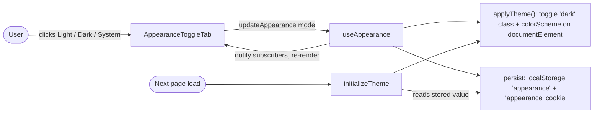
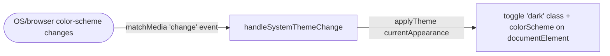

# Appearance Settings

## Summary
Lets an authenticated user choose whether the app renders in light mode, dark mode, or follows their system/browser preference, and remembers that choice across future visits.

## Business purpose
Users work in different lighting environments and have different visual preferences; letting them pick Light, Dark, or "match my system" avoids forcing one look on everyone, without requiring them to reselect it every session.

## User-facing behavior
- From an authenticated session, the user visits Settings > Appearance (`/settings/appearance`).
- The page shows a Light / Dark / System segmented control (three tab buttons with sun/moon/monitor icons).
- Clicking a tab immediately switches the app's rendered theme and highlights the selected tab.
- Choosing "System" makes the app follow the browser/OS `prefers-color-scheme` setting, including live changes to it.
- The chosen preference is remembered client-side, so the same theme is applied automatically the next time the app loads.

## Components built

### Frontend
| Component | Type | Responsibility |
|---|---|---|
| [`Appearance`](resources/js/pages/settings/appearance.tsx) | page | Renders the Appearance settings page (heading + breadcrumb via the `appearance.edit` route) and mounts the toggle tabs. |
| [`AppearanceToggleTab`](resources/js/components/appearance-tabs.tsx) | component | Renders the Light/Dark/System tab buttons, highlights whichever matches the current `appearance`, and calls `updateAppearance(value)` on click. |
| [`useAppearance`](resources/js/hooks/use-appearance.tsx) | hook | React-facing hook (via `useSyncExternalStore`) exposing `appearance`, `resolvedAppearance`, and `updateAppearance`; on update it applies the theme to the DOM and persists the choice. |
| [`initializeTheme`](resources/js/hooks/use-appearance.tsx) | function | Run on app start: defaults the stored preference to `'system'` if unset, applies the theme before render, and registers the system color-scheme change listener. |

*(No backend beyond route registration — see Access & configuration below.)*

## Business flows

### Setting the appearance preference
A signed-in user picks Light, Dark, or System on the Appearance settings page. `useAppearance` updates the in-memory preference, applies it to the page immediately, and writes it to `localStorage` and a cookie so the same theme is restored automatically on future loads via `initializeTheme`, without the user needing to reselect it.

### Following the system theme live
When the preference is "System", `initializeTheme` has registered a listener on the browser/OS `prefers-color-scheme` media query. When that query changes, the theme re-applies using the current preference, without touching the stored value.

## Data & persistence

### Client-side storage (no database table)
This feature stores nothing on the server; the preference lives entirely in the browser, managed by [`use-appearance.tsx`](resources/js/hooks/use-appearance.tsx).

| Key | Type | Description |
|---|---|---|
| `localStorage['appearance']` | `'light' \| 'dark' \| 'system'` | The user's chosen preference. Defaulted to `'system'` by `initializeTheme()` if unset, and read back on every page load to restore the theme. |
| `appearance` cookie | string; `path=/`; `max-age` 365 days; `SameSite=Lax` | Mirrors the localStorage value, set alongside it — per the code comment, "Store in cookie for SSR...". |

## Access & configuration
- **Permissions:** `/settings/appearance` is registered as `Route::inertia('settings/appearance', 'settings/appearance')->name('appearance.edit')` in [`routes/settings.php`](routes/settings.php), inside the `auth` + `verified` middleware group. It is a plain Inertia pass-through (no controller) — any authenticated, verified user can view and change the setting; there is no further authorization check.
- **Configuration:** None — no feature flags or environment variables govern this feature in the files reviewed.

## Related
- [`docs/features/profile-settings.md`](docs/features/profile-settings.md) and [`docs/features/password-confirmation.md`](docs/features/password-confirmation.md) — other pages under the same Settings area.
