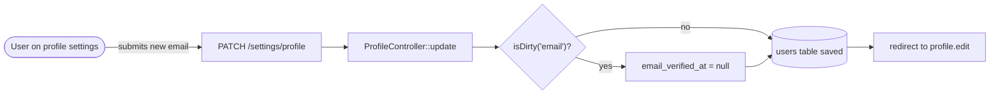

# Email Verification

## Summary
Fortify-driven email verification: an authenticated user is prompted to confirm ownership of their email address, can request a new verification link, and clicking the emailed link marks the address verified. A `verified` middleware gate exists to block unverified users from protected routes such as the dashboard.

## Business purpose
Confirms a user actually controls the email address on their account before granting access to the application, and forces re-confirmation whenever that address changes. This protects against typos or impersonation at signup/profile-edit time.

**Important accuracy note:** `App\Models\User` does **not** implement the `Illuminate\Contracts\Auth\MustVerifyEmail` contract. In `app/Models/User.php` the import is present but commented out (`// use Illuminate\Contracts\Auth\MustVerifyEmail;`) and the class declaration is `class User extends Authenticatable implements PasskeyUser` — no `MustVerifyEmail` in the `implements` list. Laravel's `Illuminate\Foundation\Auth\User` base class does use the `Illuminate\Auth\MustVerifyEmail` **trait**, so helper methods (`hasVerifiedEmail()`, `markEmailAsVerified()`, `sendEmailVerificationNotification()`, `getEmailForVerification()`) exist and work. But because the app's `User` model does not implement the **contract interface**, every `instanceof MustVerifyEmail` check in this feature evaluates to `false`. Concretely:
- `Illuminate\Auth\Middleware\EnsureEmailIsVerified` (the `verified` route middleware) only redirects when `$user instanceof MustVerifyEmail && ! $user->hasVerifiedEmail()`. Since the instanceof check is always false, this middleware **always calls `next($request)`** — it never blocks access, regardless of `email_verified_at`.
- `App\Http\Controllers\Settings\ProfileController::edit()` computes `'mustVerifyEmail' => $request->user() instanceof MustVerifyEmail`, which is therefore always `false`, so the "unverified email" banner in the profile settings page never renders.

The verification prompt page, resend action, and verify-link action still work in isolation (they rely on the trait's methods, not the contract), but nothing in the app currently *enforces* verification.

## User-facing behavior
- Visiting a route wrapped in the `verified` middleware (e.g. the dashboard) is, by Fortify's design, supposed to redirect an unverified user to the verification prompt (`GET /email/verify`) — see the accuracy note above for why this redirect never actually happens today.
- The verification prompt page (`resources/js/pages/auth/verify-email.tsx`) shows a "Resend verification email" button and a log-out link. After a resend, a green confirmation message appears when `status === 'verification-link-sent'`.
- In profile settings (`resources/js/pages/settings/profile.tsx`), when `mustVerifyEmail` is true and the user's `email_verified_at` is null, an inline banner offers a "Click here to re-send the verification email" link. Profile editing itself is documented in `docs/features/profile-settings.md` — this doc only covers the verification-related parts of that page.
- Changing the account's email address in profile settings clears `email_verified_at`, which is intended to make the account "unverified" again.

## Components built

### Backend
| Component | Type | Responsibility |
|---|---|---|
| [`FortifyServiceProvider`](app/Providers/FortifyServiceProvider.php) | provider | `configureViews()` registers `Fortify::verifyEmailView`, telling Fortify to render `Inertia::render('auth/verify-email', ['status' => ...])` for the verification prompt route. |
| [`config/fortify.php`](config/fortify.php) | config | `'features'` includes `Features::emailVerification()`, which turns on Fortify's `verification.notice` / `verification.verify` / `verification.send` routes. |
| [`routes/web.php`](routes/web.php) | routes | Wraps the `dashboard` route in `Route::middleware(['auth', 'verified'])`, intending to gate it behind email verification. |
| [`ProfileController`](app/Http/Controllers/Settings/ProfileController.php) | controller | `edit()` passes `mustVerifyEmail` (an `instanceof MustVerifyEmail` check, always `false` today) to the profile page; `update()` sets `email_verified_at = null` whenever the submitted email differs from the stored one (`isDirty('email')`). |
| [`User`](app/Models/User.php) | model | The authenticatable model. Does **not** implement `Illuminate\Contracts\Auth\MustVerifyEmail` (import commented out) — see the accuracy note above. |

### Frontend
| Component | Type | Responsibility |
|---|---|---|
| [`verify-email`](resources/js/pages/auth/verify-email.tsx) | page | Rendered for the verification prompt route. Shows a resend-email form (posts via `send.form()` from `@/routes/verification`) and a logout link; shows a success message when `status === 'verification-link-sent'`. |
| [`profile`](resources/js/pages/settings/profile.tsx) | page | Renders the inline unverified-email banner and resend link when `mustVerifyEmail && auth.user.email_verified_at === null`. (Full profile-edit behavior is out of scope for this doc — see `profile-settings.md`.) |

## Business flows

### Verification prompt → resend → click emailed link
A user with an unverified email is (by design) redirected off a `verified`-gated route to the verification prompt, can request a new email, and clicking the link in that email marks the address verified so the original route becomes reachable.

```mermaid
flowchart LR
  User([Authenticated user]) --> Dash["GET /dashboard (verified-gated)"]
  Dash -->|"auth, verified middleware"| Check{"EnsureEmailIsVerified:<br/>user instanceof MustVerifyEmail<br/>&amp;&amp; !hasVerifiedEmail?"}
  Check -->|"true (never happens today —<br/>User doesn't implement the contract)"| Notice["GET /email/verify"]
  Check -->|"false (always, today)"| DashOK[Dashboard rendered]
  Notice --> PromptCtrl[EmailVerificationPromptController]
  PromptCtrl --> View["auth/verify-email.tsx"]
  View -->|"Resend button"| Send["POST /email/verification-notification"]
  Send --> SendCtrl[EmailVerificationNotificationController]
  SendCtrl --> Notify[sendEmailVerificationNotification]
  Notify --> Mail[(Verification email sent)]
  Mail -->|"user clicks link"| Verify["GET /email/verify/{id}/{hash}<br/>(signed + throttled)"]
  Verify --> VerifyCtrl[VerifyEmailController]
  VerifyCtrl --> Mark[markEmailAsVerified]
  Mark --> DB[(users.email_verified_at)]
  Mark -->|redirect| Dash
```

### Changing email resets verification
When a user updates their email address in profile settings, the app clears `email_verified_at` so the new address is treated as unverified again.

Note: because `mustVerifyEmail` is always `false` (see accuracy note above), resetting `email_verified_at` does not currently surface the unverified banner on the profile page, nor does it cause the `verified` middleware to block subsequent access — the reset happens at the data level only.

## Data & persistence

### [`users`](database/migrations/0001_01_01_000000_create_users_table.php)
One row per account. The `email_verified_at` column is this feature's only owned field.

| Column | Type | Description |
|---|---|---|
| `email_verified_at` | `timestamp`, nullable | Null means unverified. Set to a timestamp by `VerifyEmailController::markEmailAsVerified()` when the signed verification link is followed; cleared back to `null` by `ProfileController::update()` whenever the user's email changes. |

## Access & configuration

- **Permissions:** All routes in this flow require an authenticated session (`auth` middleware, from `config/fortify.php`'s `'guard' => 'web'`). The `GET /email/verify/{id}/{hash}` route additionally requires a valid Laravel signed URL (`signed` middleware) whose `id`/`hash` match the current user (enforced in Fortify's `VerifyEmailRequest`), and is throttled per `config('fortify.limiters.verification', '6,1')`.
- **Configuration:** `config/fortify.php`'s `'features'` array must include `Features::emailVerification()` for the verification routes/views to be registered at all — it currently does. `routes/web.php` applies the `verified` middleware to the `dashboard` route to express the intended gate. Whether that gate actually blocks anyone depends on `App\Models\User` implementing `Illuminate\Contracts\Auth\MustVerifyEmail` — **it currently does not** (see accuracy note above), so the gate is inert.

## Related
- `docs/features/profile-settings.md` — profile editing (name/email form, delete account) that this feature's email-change reset and unverified-email banner live inside.
