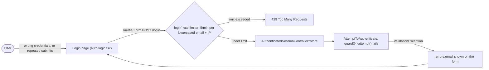

# Login (Email & Password)

## Summary
Lets a user with an existing account sign in with their email address and password, optionally staying signed in via "remember me". This starter kit has no self-registration route or page — accounts are created some other way (e.g. seeding, an admin flow, or a feature outside this doc's scope), and this doc covers only the sign-in form itself.

## Business purpose
A returning user needs a way to prove who they are before reaching authenticated areas of the app (e.g. the dashboard). The login form is the front door to that: it verifies credentials, protects against brute-force guessing, and hands off to any additional verification step (two-factor) the account requires.

## User-facing behavior
- At `/login`, the user enters their email and password and can check "Remember me" to stay signed in across browser sessions.
- The page also renders a passkey sign-in affordance (`PasskeyVerify`) alongside the password form; that is a separate sign-in method and is not covered by this doc.
- If the app has password resets enabled, a "Forgot your password?" link appears next to the Password label.
- Submitting with invalid credentials redisplays the form with a validation error under the email field and clears only the password field.
- Submitting too many times in a short window (same email + IP) is throttled and rejected before authentication runs.
- On success, the user is taken to whatever page they originally tried to visit, or to the dashboard (`/dashboard`) by default. If the account has two-factor authentication enabled, the user is redirected to the two-factor challenge instead (a separate flow, not covered here).
- An optional flashed `status` message (e.g. left over from an adjacent flow such as password reset) is shown beneath the form.

## Components built

### Backend
| Component | Type | Responsibility |
|---|---|---|
| [`FortifyServiceProvider`](app/Providers/FortifyServiceProvider.php) | provider | Renders the `auth/login` Inertia view for `GET /login` (passing `canResetPassword` and any flashed `status`), and registers the `login` rate limiter used to throttle `POST /login`. |
| [`config/fortify.php`](config/fortify.php) | config | Configures the `web` guard, the `email` username field, `lowercase_usernames`, the post-login `home` redirect (`/dashboard`), which named limiter guards the login route (`limiters.login`), and which optional features (password reset, two-factor authentication) are enabled. |
| [`AuthenticatedSessionController`](vendor/laravel/fortify/src/Http/Controllers/AuthenticatedSessionController.php) | controller | Handles `GET /login` (renders the login view) and `POST /login` (runs the login pipeline: canonicalize the username, hand off to the two-factor challenge if applicable, attempt authentication against the `web` guard, then regenerate the session). |
| [`LoginResponse`](vendor/laravel/fortify/src/Http/Responses/LoginResponse.php) | response | Builds the redirect returned after a successful login — to the originally intended URL, or to `fortify.home` (`/dashboard`) otherwise. |
| [`routes/web.php`](routes/web.php) | endpoint | Defines the `dashboard` route (behind `auth` + `verified` middleware) that a successful login lands on by default. |

### Frontend
| Component | Type | Responsibility |
|---|---|---|
| [`Login`](resources/js/pages/auth/login.tsx) | page | Renders the email/password/remember-me form, submits it via Inertia's `Form` component to `login.store` (`POST /login`), shows field validation errors, the "Forgot your password?" link (when `canResetPassword`), and any flashed `status` message. |
| [`AuthLayout`](resources/js/layouts/auth-layout.tsx) | layout | Wraps every `auth/*` page (including login) — `resources/js/app.tsx` maps page names starting with `auth/` to this layout — passing through the page's `title`/`description`. |
| [`AuthSimpleLayout`](resources/js/layouts/auth/auth-simple-layout.tsx) | component | Centers the auth card, shows the app logo linking to the home route, and renders the `title`/`description` heading above the form. |

## Business flows

### Successful login
A user submits valid credentials; Fortify authenticates them against the `web` guard, regenerates the session, and redirects them to the page they originally wanted (or the dashboard).

```mermaid
flowchart LR
  User([User]) -->|"email + password (+ remember)"| LoginPage["Login page (auth/login.tsx)"]
  LoginPage -->|"Inertia Form POST /login"| Route["POST /login (guest + throttle:login)"]
  Route --> Controller["AuthenticatedSessionController::store"]
  Controller --> Canon["CanonicalizeUsername (lowercase email)"]
  Canon --> TwoFA{"2FA enabled for this user?"}
  TwoFA -->|no| Attempt["AttemptToAuthenticate: guard()->attempt(email, password, remember)"]
  TwoFA -->|yes| Challenge["Redirect to two-factor challenge (separate doc)"]
  Attempt -->|credentials valid| Prepare["PrepareAuthenticatedSession: session()->regenerate()"]
  Prepare --> Response["LoginResponse"]
  Response -->|"redirect()->intended() or /dashboard"| Dashboard["dashboard route"]
```

### Failed attempts and rate limiting
A user enters the wrong password, or the same email/IP pair has submitted too many login attempts recently. Fortify rejects the request — either with a validation error, or (once the limit is hit) before authentication logic even runs.

Note: because `fortify.limiters.login` is set to a named limiter (`login`), Fortify's own pipeline throttle step (`EnsureLoginIsNotThrottled`) is skipped; the limit is instead enforced by the standard Laravel `throttle:login` route middleware, using the `login` limiter registered in [`FortifyServiceProvider`](app/Providers/FortifyServiceProvider.php).

## Access & configuration

- **Permissions:** Both `GET /login` and `POST /login` carry a `guest:web` middleware (registered by Fortify's own route file), so only unauthenticated sessions can view or submit the form.
- **Configuration:**
  - [`config/fortify.php`](config/fortify.php) — `guard` (`web`), `username` (`email`), `lowercase_usernames` (`true`, canonicalizes the email before the auth attempt), `home` (`/dashboard`, the default post-login redirect), `limiters.login` (`login`, names the rate limiter enforced on `POST /login`), and `features` (enabling `resetPasswords()` drives the `canResetPassword` prop and "Forgot your password?" link; enabling `twoFactorAuthentication()` adds the 2FA redirect step to the login pipeline).
  - [`FortifyServiceProvider::configureRateLimiting()`](app/Providers/FortifyServiceProvider.php) — defines the `login` limiter as 5 attempts/minute, keyed by the lowercased, transliterated email plus the request IP.

## Related
- Two-factor challenge — the login pipeline hands off here when the authenticating user has two-factor authentication enabled. Not yet documented separately.
- Password reset / "Forgot your password?" — reachable from this page when the `resetPasswords` feature is enabled. Not yet documented separately.
