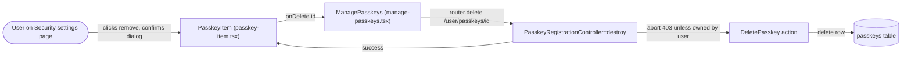

# Passkeys (WebAuthn Authentication)

## Summary
Lets a user register, verify with, and manage device-bound WebAuthn "passkeys" as a passwordless alternative to typing a password — for signing in and for re-confirming their identity on sensitive actions.

## Business purpose
Passwords can be phished, reused, or forgotten. Passkeys let a user authenticate with a public-key credential backed by their device's own authenticator (Touch ID, Windows Hello, a security key, etc.), which requires user verification (biometric or PIN) and is bound to a single site, so it can't be replayed elsewhere. Because registration requires a discoverable ("resident") credential, a user can sign in without even typing a username or email first.

## User-facing behavior
- On the Security settings page, a "Passkeys" section lists the user's registered passkeys — each showing its name, an authenticator badge when recognized, and "Added … ago" / "Last used … ago" timestamps — or an empty state ("No passkeys yet — Add a passkey to sign in without a password") when none exist.
- To add one, the user clicks "Add passkey", is given a suggested name pre-filled from their browser/OS (e.g. "Chrome on Mac"), can edit it, then clicks "Register passkey" and completes their device's WebAuthn prompt.
- To remove one, the user clicks the trash icon on that passkey and confirms in a "Remove passkey" dialog, which warns they'll no longer be able to sign in with it.
- On the login page, and on the password-confirmation page, a "Sign in with a passkey" / "Confirm with a passkey" button appears as an alternative to typing a password — but only in browsers that support WebAuthn (`isSupported`); otherwise the button (or, on the registration form, the whole control) doesn't render.

## Components built

### Backend
| Component | Type | Responsibility |
|---|---|---|
| [`SecurityController::edit`](app/Http/Controllers/Settings/SecurityController.php) | controller | Renders `settings/security`, passing `canManagePasskeys` (from `Features::canManagePasskeys()`) and the authenticated user's passkeys — mapped to `id`, `name`, `authenticator`, `created_at_diff`, `last_used_at_diff` — or an empty array when the feature is off |
| [`FortifyServiceProvider::configureRateLimiting`](app/Providers/FortifyServiceProvider.php) | service provider | Registers the `passkeys` rate limiter: 10 requests/minute, keyed by the submitted `credential.id` (falling back to the session ID) plus the requester's IP |
| [`config/fortify.php`](config/fortify.php) | configuration | Enables `Features::passkeys(['confirmPassword' => true])`, sets the WebAuthn relying-party ID / allowed origins / user-handle secret / timeout, and names the `passkeys` rate limiter |
| [`.well-known/passkey-endpoints` route](routes/settings.php) | endpoint | Returns JSON `{ enroll, manage }`, both pointing at `security.edit`, so platforms/password managers can discover where passkeys are managed |
| [`create_passkeys_table` migration](database/migrations/2024_01_01_000000_create_passkeys_table.php) | migration | Defines the `passkeys` table |
| [`User`](app/Models/User.php) | model | Implements the `PasskeyUser` contract via the `PasskeyAuthenticatable` trait, giving each user a `passkeys()` relation and WebAuthn identity methods |

### Frontend
| Component | Type | Responsibility |
|---|---|---|
| [`Security`](resources/js/pages/settings/security.tsx) | page | Security settings page; renders `ManagePasskeys` with the `canManagePasskeys` / `passkeys` props from `SecurityController` |
| [`ManagePasskeys`](resources/js/components/manage-passkeys.tsx) | component | Lists passkeys (or the empty state), wires deletion, and reloads the page's props after a successful registration |
| [`PasskeyRegistration`](resources/js/components/passkey-register.tsx) | component | "Add passkey" form; suggests a name from the browser/OS and drives WebAuthn credential creation via `usePasskeyRegister` |
| [`PasskeyItem`](resources/js/components/passkey-item.tsx) | component | Renders one passkey row (name, authenticator badge, timestamps) with a remove-confirmation dialog |
| [`PasskeyVerify`](resources/js/components/passkey-verify.tsx) | component | "Sign in / confirm with a passkey" button; drives a WebAuthn assertion via `usePasskeyVerify`, configurable with custom `routes` so it can target either the login or password-confirmation endpoints |

## Business flows

### Registering a new passkey
A signed-in user adds a new passkey from the Security settings page so they can use it to sign in (or re-confirm their identity) going forward.

```mermaid
flowchart LR
  User([User on Security settings page]) -->|clicks "Add passkey", names it, submits| Register["PasskeyRegistration (passkey-register.tsx)"]
  Register -->|usePasskeyRegister fetches options| OptionsAPI["GET /user/passkeys/options"]
  OptionsAPI --> RegIndex["PasskeyRegistrationController::index"]
  RegIndex --> GenOpts["GenerateRegistrationOptions"]
  GenOpts -->|creation options + challenge, stored in session| Register
  Register -->|navigator.credentials.create| Authenticator[(Device authenticator)]
  Authenticator -->|new public-key credential| Register
  Register -->|POST /user/passkeys with name + credential| RegStore["PasskeyRegistrationController::store"]
  RegStore --> StoreAction["StorePasskey action"]
  StoreAction -->|validate attestation, ensure credential_id unique| DB[(passkeys table)]
  RegStore -->|success| Register
  Register -->|onSuccess -> router.reload| Manage["ManagePasskeys reloads security.edit props"]
```

The registration (and removal) endpoints require a recently confirmed password — gated by `Features::passkeys(['confirmPassword' => true])` — and are throttled by the `passkeys` rate limiter.

### Signing in / confirming identity with a passkey
A user on the login page, or on the password-confirmation page, chooses to authenticate with a passkey instead of typing their password.

```mermaid
flowchart LR
  User([User clicks "Sign in / Confirm with a passkey"]) --> Verify["PasskeyVerify (passkey-verify.tsx)"]
  Verify -->|usePasskeyVerify fetches options| OptionsAPI["GET .../login/options or /confirm/options"]
  OptionsAPI --> LoginIndex["PasskeyLoginController::index or PasskeyConfirmationController::index"]
  LoginIndex --> GenVerify["GenerateVerificationOptions"]
  GenVerify -->|request options + challenge, stored in session| Verify
  Verify -->|navigator.credentials.get| Authenticator[(Device authenticator)]
  Authenticator -->|signed assertion| Verify
  Verify -->|POST credential to /login or /confirm| Submit["PasskeyLoginController::store or PasskeyConfirmationController::store"]
  Submit --> VerifyAction["VerifyPasskey action"]
  VerifyAction -->|look up by credential_id, validate signature| DB[(passkeys table)]
  VerifyAction -->|update credential + last_used_at| DB
  Submit -->|log in / confirm, regenerate session| Verify
  Verify -->|onSuccess -> router.visit| Dest[Redirected destination]
```

### Removing a passkey
A user decides a passkey is no longer trusted or available (e.g. a lost device) and removes it from their account.



## Data & persistence

### [`passkeys`](database/migrations/2024_01_01_000000_create_passkeys_table.php)
One row per registered WebAuthn credential, owned by exactly one user.

| Column | Type | Description |
|---|---|---|
| `id` | bigint (PK) | Unique identifier for the passkey record |
| `user_id` | foreign id | Owning user (`users.id`); cascade-deletes when the user is deleted; indexed |
| `name` | string | User-supplied label shown in the Security settings list (e.g. "MacBook Pro") |
| `credential_id` | string, unique | The WebAuthn credential ID (base64url); used to look up the passkey during verification and to build exclude/allow-credential lists |
| `credential` | json | Serialized WebAuthn credential record (public key, signature counter, AAGUID, etc.); re-saved after every successful verification to persist the updated signature counter |
| `last_used_at` | timestamp, nullable | Set on each successful verification; drives the "Last used … ago" text, `null` if never used |
| `created_at` / `updated_at` | timestamps | Standard Eloquent timestamps; `created_at` drives the "Added … ago" text |

The `authenticator` field seen in the UI (e.g. as a badge on each `PasskeyItem`) is not a stored column — it's an accessor computed from the AAGUID inside `credential`.

## Access & configuration

- **Permissions:** All passkey routes require an authenticated user. Registering (`store`) and removing (`destroy`) a passkey additionally require the user's password to have been recently confirmed, since `config/fortify.php` sets `Features::passkeys(['confirmPassword' => true])`. The Security settings page itself (`settings/security` in [`routes/settings.php`](routes/settings.php)) is further gated by the `RequirePassword` middleware. Deletion is scoped server-side — `PasskeyRegistrationController::destroy` aborts with 403 unless the passkey's `user_id` matches the authenticated user — and verification is scoped the same way when a user context is known. The whole feature is hidden from the Security page (`passkeys` prop becomes `[]`, `ManagePasskeys` renders nothing) when `Features::canManagePasskeys()` is false.
- **Configuration:** [`config/fortify.php`](config/fortify.php) — the `passkeys` feature toggle and its `confirmPassword` option; the `passkeys` array (`relying_party_id`, `allowed_origins`, `user_handle_secret`, `timeout` for the WebAuthn ceremony); and `limiters.passkeys`, which names the `passkeys` rate limiter defined in [`FortifyServiceProvider`](app/Providers/FortifyServiceProvider.php) (10 requests/minute per credential ID or session + IP) applied to all passkey endpoints.

## Related
- [`docs/features/password-confirmation.md`](password-confirmation.md) — `PasskeyVerify` is also embedded on the password-confirmation page as an alternative to re-entering the password, gated by the same `RequirePassword` middleware documented there.
