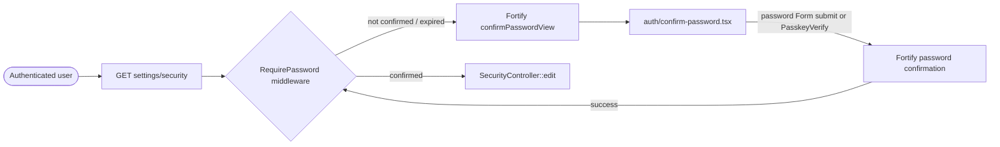

# Password Confirmation

## Summary
A re-authentication gate that requires an already-logged-in user to re-enter their password (or verify with a passkey) before reaching the security settings page, using Laravel's `RequirePassword` middleware paired with Fortify's confirm-password flow.

## Business purpose
Prevents someone with access to an already-authenticated session (e.g. an unattended, unlocked browser) from changing sensitive account security settings — password, two-factor authentication, passkeys — without re-proving they know the account password.

## User-facing behavior
- A signed-in, verified user navigating to `settings/security` is redirected to the confirm-password screen if their password confirmation has expired or was never given.
- The confirm-password page offers two ways to confirm: entering the current password, or verifying with a registered passkey.
- On successful confirmation, the user is sent on to the page they originally requested (`settings/security`).
- Enabling/managing two-factor authentication or passkeys is likewise configured to require this confirmation (`config/fortify.php`), since those actions live behind the same `security.edit` route.

## Components built

### Backend
| Component | Type | Responsibility |
|---|---|---|
| [`FortifyServiceProvider::configureViews`](app/Providers/FortifyServiceProvider.php) | service provider | Binds Fortify's `confirmPasswordView` to render the `auth/confirm-password` Inertia page |
| [`RequirePassword` middleware on `security.edit`](routes/settings.php) | middleware (route-level) | Gates the `GET settings/security` route, redirecting to the confirm-password flow if the password hasn't been recently confirmed |
| [`config/fortify.php`](config/fortify.php) | configuration | Enables `confirmPassword` for the `twoFactorAuthentication` and `passkeys` features |

### Frontend
| Component | Type | Responsibility |
|---|---|---|
| [`ConfirmPassword`](resources/js/pages/auth/confirm-password.tsx) | page | Renders the password-confirmation form (via Inertia `Form` posting to `password/confirm`) and an alternative passkey-verification flow (`PasskeyVerify`, using `PasskeyConfirmationController` routes) |

## Business flows

### Confirming password before reaching a protected settings page
A user who is already authenticated tries to open the security settings page. The `RequirePassword` middleware on that route intercepts the request, sends the user to confirm their password (or passkey), and — once confirmed — lets the original request through.

## Access & configuration

- **Permissions:** Requires an authenticated, email-verified session — `security.edit` sits inside the `['auth', 'verified']` route group in [`routes/settings.php`](routes/settings.php), with `RequirePassword` additionally applied to that route.
- **Configuration:** [`config/fortify.php`](config/fortify.php) sets `'confirmPassword' => true` for both `Features::twoFactorAuthentication()` and `Features::passkeys()`, meaning managing those features also requires this confirmation.

## Related
None yet — `docs/features` and `docs/architecture` have no other entries at this time.
