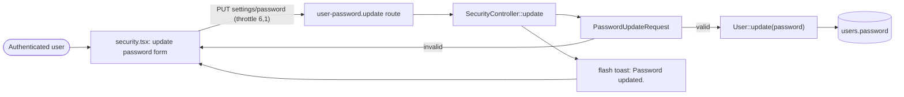

# Change Password (Security Settings)

## Summary
Lets an already-authenticated user change their account password from the security settings page by confirming their current password and setting a new one.

## Business purpose
Gives users a self-service way to update their password when they still know their current one — for example after a suspected compromise or as routine hygiene — without going through the forgotten-password reset flow.

## User-facing behavior
- On `settings/security`, the user fills in "Current password", "New password", and "Confirm password".
- Each password field has a show/hide toggle (eye icon).
- Submitting sends `PUT settings/password`.
- On success: a "Password updated." toast is flashed and the password fields are cleared (`resetOnSuccess`).
- On validation error: the password fields are cleared (`resetOnError`) and the first invalid field — `password` or `current_password` — is refocused, with its specific error message shown beneath it.
- Submissions to this endpoint are rate-limited to 6 requests per minute (`throttle:6,1`); once exceeded, further attempts are rejected until the window resets.

## Components built

### Backend
| Component | Type | Responsibility |
|---|---|---|
| [`SecurityController`](app/Http/Controllers/Settings/SecurityController.php) | controller | `update()` validates the request, writes the new password onto the authenticated user, flashes a success toast, and redirects back |
| [`PasswordUpdateRequest`](app/Http/Requests/Settings/PasswordUpdateRequest.php) | form request | Declares validation rules for `current_password` and `password` |
| [`PasswordValidationRules`](app/Concerns/PasswordValidationRules.php) | concern (trait) | Defines `currentPasswordRules()` (`required`, `string`, `current_password`) and `passwordRules()` (`required`, `string`, `Password::default()`, `confirmed`) |

### Frontend
| Component | Type | Responsibility |
|---|---|---|
| [`security.tsx`](resources/js/pages/settings/security.tsx) | page | Renders the "Update password" form (current/new/confirm fields), submits to `SecurityController.update`, and handles reset/refocus behavior on error or success |
| [`PasswordInput`](resources/js/components/password-input.tsx) | component | Masked text input with a show/hide toggle button, used for all three password fields |

## Business flows

### Update password
An authenticated user on the security settings page enters their current password plus a new password (typed twice) to change their credential. The server validates the current password and the new password's complexity before persisting it, then returns the user to the same page with a success toast. Requests are throttled to 6 per minute.

Validation detail: `current_password` must match the authenticated user's existing password (Laravel's `current_password` rule); `password` must satisfy `Password::default()` and be `confirmed` (match `password_confirmation`).

## Data & persistence

### [`users`](database/migrations/0001_01_01_000000_create_users_table.php) (via [`User`](app/Models/User.php))
Each row is one account; this flow only writes the `password` column.

| Column | Type | Description |
|---|---|---|
| `password` | `string` (cast `hashed`) | The account's password. Overwritten with the new value submitted on this form; the `hashed` cast on `User` rehashes it automatically on save. |

## Access & configuration
- **Permissions:** Requires an authenticated session (`auth` and `verified` middleware on the route group in [`routes/settings.php`](routes/settings.php)). The controller always operates on `$request->user()`, so a user can only ever change their own password.
- **Configuration:** The `PUT settings/password` route (`user-password.update`) is rate-limited via `throttle:6,1`. New-password complexity is governed by Laravel's `Password::default()` rule; the same rule set is exposed to the frontend as the `passwordRules` prop, passed to `PasswordInput` as the `passwordrules` attribute for browser autofill hints.

## Related
- Forgotten-password reset flow — `docs/features/password-reset.md`
- Password confirmation gate (`RequirePassword` middleware guarding `settings/security`) — `docs/features/password-confirmation.md`
