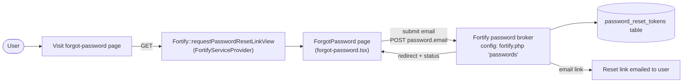
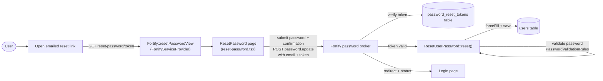

# Password Reset

## Summary
Lets a user who has forgotten their password request a reset link by email and use it to set a new password, without needing to be logged in.

## Business purpose
Users who cannot log in because they've forgotten their password need a self-service way to regain access to their account without contacting support.

## User-facing behavior
- On the login page, a user who can't log in navigates to the "forgot password" page and submits their email address.
- The application emails a reset link (handled by Fortify's password broker configured in `config/fortify.php`) and shows a status message confirming it was sent.
- Clicking the emailed link opens a reset-password page pre-filled with the user's email and containing the reset token.
- The user enters and confirms a new password. Submitting validates the password and, on success, saves it to their account.

## Components built

### Backend
| Component | Type | Responsibility |
|---|---|---|
| [`ResetUserPassword`](app/Actions/Fortify/ResetUserPassword.php) | action | Implements Fortify's `ResetsUserPasswords` contract: validates the submitted password against the app's password rules, then force-fills and saves it on the `User` model. |
| [`PasswordValidationRules`](app/Concerns/PasswordValidationRules.php) | concern (trait) | Supplies the shared `passwordRules()` (`required`, `string`, `Password::default()`, `confirmed`) used to validate the new password. |
| [`FortifyServiceProvider`](app/Providers/FortifyServiceProvider.php) | service provider | Registers `ResetUserPassword` via `Fortify::resetUserPasswordsUsing()`, and renders the `auth/forgot-password` and `auth/reset-password` Inertia views (`requestPasswordResetLinkView` / `resetPasswordView`) with the props each page needs. |
| [`fortify.php`](config/fortify.php) | config | Enables the feature via `Features::resetPasswords()` in the `features` array, and sets the password broker (`passwords => 'users'`) and username/email field name (`username`/`email => 'email'`) used by the reset flow. |
| [`0001_01_01_000000_create_users_table`](database/migrations/0001_01_01_000000_create_users_table.php) | migration | Creates the `password_reset_tokens` table that stores outstanding reset tokens. |

### Frontend
| Component | Type | Responsibility |
|---|---|---|
| [`ForgotPassword`](resources/js/pages/auth/forgot-password.tsx) | page | Renders the email-entry form (posts to the `password.email` route), shows a `status` flash message, and links back to login. |
| [`ResetPassword`](resources/js/pages/auth/reset-password.tsx) | page | Renders the new-password form (posts to the `password.update` route), pre-filled/read-only `email` and hidden `token` transformed into the submission, with `password` and `password_confirmation` fields validated client-side using the server-supplied `passwordRules` string. |

## Business flows

### Requesting a reset link
A user who can't log in visits the forgot-password page, submits their email, and — if it matches an account — receives an emailed reset link. The page shows a generic status message either way.

### Resetting via the emailed token
The user follows the link from the email, lands on the reset-password page with their email and token pre-populated, and submits a new password. The backend re-validates the token and password before saving.

## Data & persistence

### [`password_reset_tokens`](database/migrations/0001_01_01_000000_create_users_table.php)
Each row represents one outstanding password-reset request for an email address; a new request overwrites the prior row for that email since `email` is the primary key.

| Column | Type | Description |
|---|---|---|
| `email` | `string` (primary key) | The email address the reset token was issued for; also identifies the `users` row to update once the token is redeemed. |
| `token` | `string` | The (hashed) reset token sent to the user, checked against the token submitted on the reset-password form. |
| `created_at` | `timestamp`, nullable | When the token was issued; used to expire old reset requests. |

## Access & configuration

- **Permissions:** Unauthenticated (guest) users only — this is the recovery path for someone who is not logged in. Changing a password while authenticated is a separate flow (see Related).
- **Configuration:**
  - `config/fortify.php` `features` array — the whole reset-password flow is only registered when `Features::resetPasswords()` is present.
  - `config/fortify.php` `passwords` — the password broker (`'users'`) Fortify uses to issue and verify tokens.
  - `config/fortify.php` `username` / `email` — the field name (`'email'`) expected on the forgot-password and reset-password forms.
  - `config/fortify.php` `lowercase_usernames` — whether the email is lowercased before lookup.
  - Password strength rules come from `Password::default()` (used in `PasswordValidationRules::passwordRules()`) and are also serialized via `Password::defaults()->toPasswordRulesString()` in `FortifyServiceProvider` so the `reset-password.tsx` inputs get matching client-side `passwordrules`.

## Related
- [Password management](docs/features/password-management.md) — changing a known password while authenticated (not covered here).
- [Password confirmation](docs/features/password-confirmation.md) — re-confirming a password before sensitive actions.
