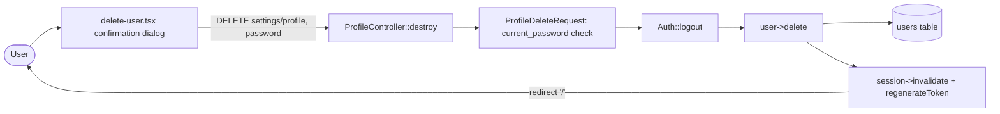

# Profile Settings

## Summary
Lets an authenticated user view and update their profile information (name and email address) and permanently delete their own account.

## Business purpose
Users need self-service control over the identity details tied to their account and the ability to remove their account and data entirely, without needing an administrator to act on their behalf.

## User-facing behavior
- On the profile settings page, the user sees their current name and email in a form and can edit either field.
- Saving the form validates and persists the changes; if the email address was changed, the account's verification status is reset (`email_verified_at` is cleared) and the user is shown an "unverified" notice with a link to resend the verification email (only when the app requires email verification).
- A separate "Delete account" panel, shown below the profile form, lets the user open a confirmation dialog, enter their current password, and permanently delete the account. On success the user is logged out and redirected to the homepage.

## Components built

### Backend
| Component | Type | Responsibility |
|---|---|---|
| [`ProfileController`](app/Http/Controllers/Settings/ProfileController.php) | controller | Renders the profile settings page (`edit`), applies validated name/email changes and clears `email_verified_at` when the email changes (`update`), and logs out, deletes, and invalidates the session for account deletion (`destroy`). |
| [`ProfileUpdateRequest`](app/Http/Requests/Settings/ProfileUpdateRequest.php) | form request | Validates the `name`/`email` payload for profile updates using `ProfileValidationRules`. |
| [`ProfileDeleteRequest`](app/Http/Requests/Settings/ProfileDeleteRequest.php) | form request | Validates that the submitted `password` matches the user's current password (via `PasswordValidationRules::currentPasswordRules`) before allowing deletion. |
| [`ProfileValidationRules`](app/Concerns/ProfileValidationRules.php) | trait (validation rules) | Defines the `name` (required, string, max 255) and `email` (required, string, email, max 255, unique on `users` ignoring the current user) rules shared by profile validation. |
| [`routes/settings.php`](routes/settings.php) | route definitions | Registers `profile.edit` and `profile.update` behind `auth`, and `profile.destroy` behind `auth` + `verified`. |

### Frontend
| Component | Type | Responsibility |
|---|---|---|
| [`settings/profile.tsx`](resources/js/pages/settings/profile.tsx) | page | Renders the name/email form (bound to `ProfileController.update`), shows the unverified-email notice and resend link when applicable, and renders the `DeleteUser` component. |
| [`delete-user.tsx`](resources/js/components/delete-user.tsx) | component | Renders the "Delete account" warning panel and confirmation dialog, collecting the current password and submitting to `ProfileController.destroy`. |

## Business flows

### Updating name/email
A signed-in user edits their name and/or email on the profile settings page and submits the form. The controller fills the validated attributes onto the user model and saves it; if the email address actually changed, `email_verified_at` is nulled before saving, so the account reverts to an unverified state and must be re-verified (see the email-verification feature doc for that flow).

```mermaid
flowchart LR
  User([User]) --> Page[settings/profile.tsx form]
  Page -->|PATCH settings/profile| Update[ProfileController::update]
  Update --> Validate[ProfileUpdateRequest / ProfileValidationRules]
  Validate --> Fill[user->fill(validated)]
  Fill -->|email changed?| NullVerified[email_verified_at = null]
  Fill --> Save[(users table)]
  NullVerified --> Save
  Save -->|flash success toast, redirect| Page
```

### Deleting the account
From the profile settings page, the user opens the delete-account dialog, enters their current password, and confirms. The controller logs the user out, deletes the user record, then invalidates and regenerates the session before redirecting to the homepage. This route requires the user to be authenticated and email-verified.



## Data & persistence

### [`users`](app/Models/User.php)
Each row is one account; this feature reads and writes the identity and verification fields, and removes the row entirely on deletion.

| Column | Type | Description |
|---|---|---|
| `name` | string | Updated directly from the validated `name` input. |
| `email` | string | Updated from the validated `email` input; must be unique among users (ignoring the current user's own row). |
| `email_verified_at` | timestamp, nullable | Set to `null` by `ProfileController::update` whenever the `email` value changes, forcing re-verification. |

## Access & configuration
- **Permissions:** `profile.edit` and `profile.update` require the `auth` middleware (`routes/settings.php`). `profile.destroy` additionally requires the `verified` middleware, so an unverified user cannot delete their account. Deletion also requires re-entering the current password, enforced by `ProfileDeleteRequest`'s `current_password` rule.
- **Configuration:** None specific to this feature beyond the route middleware noted above.

## Related
- Email verification internals (resend link, verification flow) — `docs/features/email-verification.md`
- Password and two-factor/passkey security settings — security settings documentation
