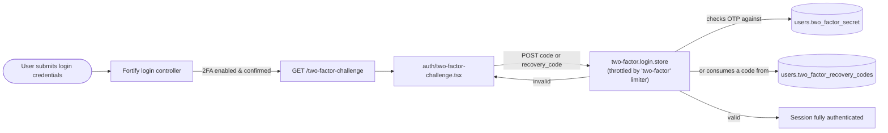
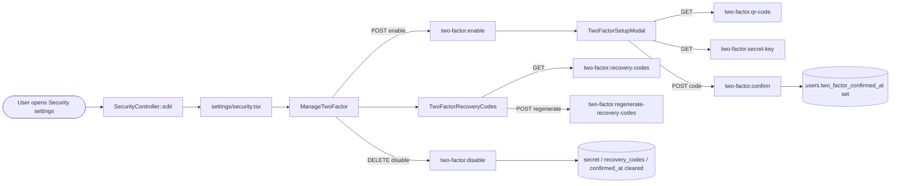

# Two-Factor Authentication

## Summary
Lets a user protect their account with TOTP-based two-factor authentication (an authenticator-app code, with recovery codes as a backup), both at login time and when enabling/disabling it from the security settings page.

## Business purpose
Adds a second proof of identity beyond the password, so a leaked or guessed password alone isn't enough to sign in to an account that has 2FA turned on.

## User-facing behavior
- **At login:** if the account has two-factor authentication enabled and confirmed, the user is shown a challenge screen after entering their password. They enter a 6-digit code from their authenticator app, or switch to entering one of their recovery codes instead.
- **In Security settings:** a user can enable 2FA, scan a QR code (or copy a manual setup key) into their authenticator app, and confirm the setup with a one-time code before it takes effect. Once enabled, they can view or regenerate their recovery codes, or disable 2FA entirely.

## Components built

### Backend
| Component | Type | Responsibility |
|---|---|---|
| [`SecurityController`](app/Http/Controllers/Settings/SecurityController.php) | controller | Builds the `settings/security` page props (`canManageTwoFactor`, `twoFactorEnabled`, `requiresConfirmation`) and calls `ensureStateIsValid()` before rendering |
| [`TwoFactorAuthenticationRequest`](app/Http/Requests/Settings/TwoFactorAuthenticationRequest.php) | form request | Uses Fortify's `InteractsWithTwoFactorState` trait so an abandoned/never-confirmed 2FA setup is cleaned up (secret cleared) each time the security page is requested |
| [`FortifyServiceProvider`](app/Providers/FortifyServiceProvider.php) | service provider | Registers the `auth/two-factor-challenge` Inertia view for the login challenge and the `two-factor` rate limiter used to throttle challenge attempts |
| [`config/fortify.php`](config/fortify.php) | config | Enables the `twoFactorAuthentication` feature with `confirm` and `confirmPassword` options, and maps the `two-factor` limiter name |
| [`routes/settings.php`](routes/settings.php) | route | Defines `GET settings/security` (`security.edit`), gated by `auth`, `verified`, and `RequirePassword` middleware |
| [`2025_08_14_170933_add_two_factor_columns_to_users_table`](database/migrations/2025_08_14_170933_add_two_factor_columns_to_users_table.php) | migration | Adds `two_factor_secret`, `two_factor_recovery_codes`, and `two_factor_confirmed_at` to `users` |
| [`User`](app/Models/User.php) | model | Uses Fortify's `TwoFactorAuthenticatable` trait; casts `two_factor_confirmed_at` to `datetime`; hides `two_factor_secret`/`two_factor_recovery_codes` from serialization |

### Frontend
| Component | Type | Responsibility |
|---|---|---|
| [`two-factor-challenge`](resources/js/pages/auth/two-factor-challenge.tsx) | page | Login-time challenge screen: OTP input or recovery-code input with a toggle between the two, submits to the challenge store endpoint |
| [`security`](resources/js/pages/settings/security.tsx) | page | Security settings page; renders `ManageTwoFactor` (and `ManagePasskeys`) alongside the password-change form |
| [`ManageTwoFactor`](resources/js/components/manage-two-factor.tsx) | component | Enable/disable 2FA card; opens the setup modal, shows recovery-code management once enabled, and clears local setup state when 2FA is disabled |
| [`TwoFactorSetupModal`](resources/js/components/two-factor-setup-modal.tsx) | component | Two-step modal: QR code/manual key step, then (when `requiresConfirmation` is true) an OTP confirmation step |
| [`TwoFactorRecoveryCodes`](resources/js/components/two-factor-recovery-codes.tsx) | component | Reveals/hides and regenerates the user's recovery codes |
| [`useTwoFactorAuth`](resources/js/hooks/use-two-factor-auth.ts) | hook | Fetches the QR code SVG, manual setup key, and recovery codes via `useHttp().submit()`; tracks fetch errors and exposes `OTP_MAX_LENGTH` (6) |

## Business flows

### Login challenge
Once a user with a confirmed, enabled 2FA setup submits the correct password, Fortify diverts them to a challenge step: they must prove possession of their authenticator device (or supply a recovery code) before the session is fully authenticated.

### Setup, confirmation, recovery codes & disable
From Security settings, a user turns 2FA on, scans the QR code (or copies the manual key) into an authenticator app, and — because `config/fortify.php` sets `confirm` to `true` — must submit one valid one-time code before the account is actually treated as protected. Afterward they can reveal or regenerate their recovery codes, or disable 2FA again.

## Data & persistence

### [`users` two-factor columns](database/migrations/2025_08_14_170933_add_two_factor_columns_to_users_table.php)
Added to the existing `users` table by this migration and read/written through [`User`](app/Models/User.php)'s `TwoFactorAuthenticatable` trait; they hold everything needed to verify a code and to recover access if the authenticator device is lost.

| Column | Type | Description |
|---|---|---|
| `two_factor_secret` | `text`, nullable | The user's TOTP secret, encrypted with Fortify's configured encrypter; decrypted only to render the QR code or verify a submitted OTP. Hidden from model serialization via `#[Hidden]` on `User`. |
| `two_factor_recovery_codes` | `text`, nullable | JSON array of one-time recovery codes, encrypted the same way as the secret; a used code is replaced in place, and the full list can be regenerated. Hidden from model serialization. |
| `two_factor_confirmed_at` | `timestamp`, nullable | Set once the user confirms setup with a valid OTP. Because the `confirm` option is enabled, `hasEnabledTwoFactorAuthentication()` only treats 2FA as "on" once both `two_factor_secret` and this column are non-null. Cast to `datetime`. |

## Access & configuration

- **Permissions:** reaching or managing 2FA requires the `auth` and `verified` middleware, plus Laravel's `RequirePassword` middleware on the `security.edit` route (see [Password Confirmation](password-confirmation.md)). The `canManageTwoFactor` prop passed to the settings page is gated by `Features::canManageTwoFactorAuthentication()`, which reflects whether `Features::twoFactorAuthentication()` is present in `config/fortify.php`.
- **Configuration:** [`config/fortify.php`](config/fortify.php) enables `twoFactorAuthentication` with `'confirm' => true` (an OTP must be confirmed before 2FA counts as enabled) and `'confirmPassword' => true`; the `window` option is left commented out. The `two-factor` entry in `limiters` points the challenge-verification route at the `two-factor` `RateLimiter` defined in [`FortifyServiceProvider`](app/Providers/FortifyServiceProvider.php), which allows 5 attempts per minute keyed by the pending login session's `login.id`.

## Related
- [Password Confirmation](password-confirmation.md) — the re-authentication gate in front of the security settings page.
- [Passkeys (WebAuthn Authentication)](passkeys.md) — the other identity-verification method managed on the same settings page.
- [Change Password (Security Settings)](password-management.md) — the password-change form on the same page.
- [Login (Email & Password)](login.md) — the sign-in flow that triggers the two-factor challenge.
